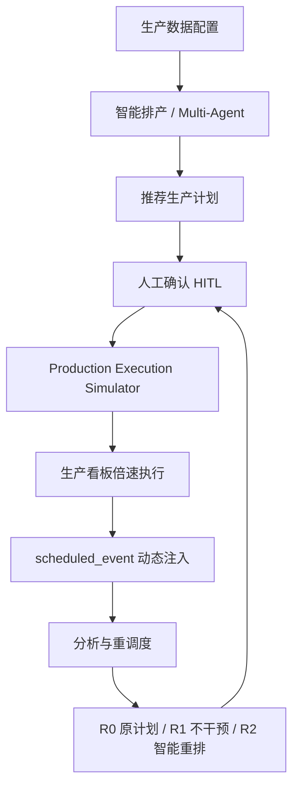
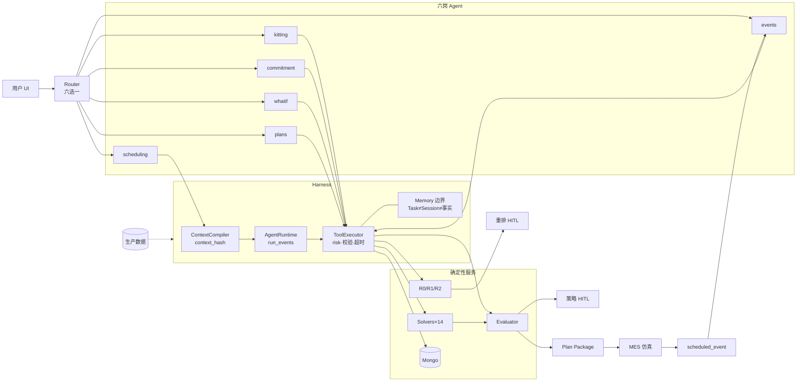
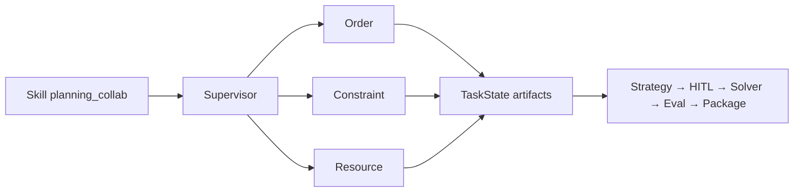
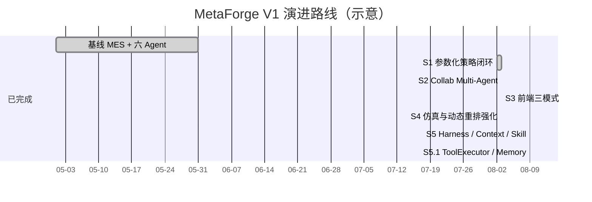
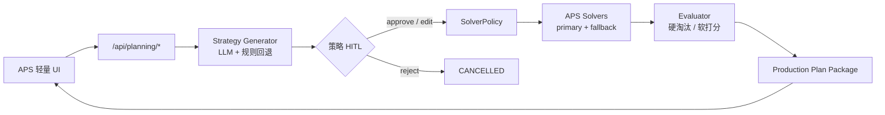
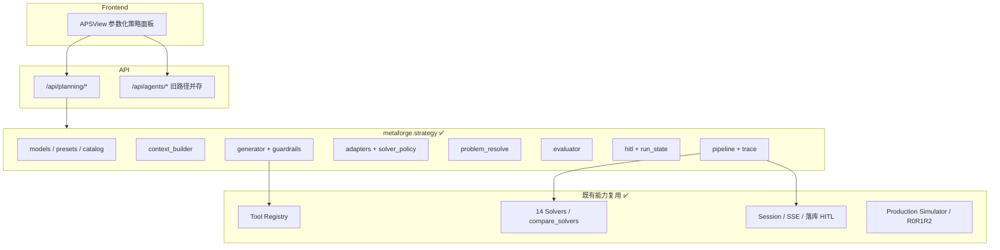
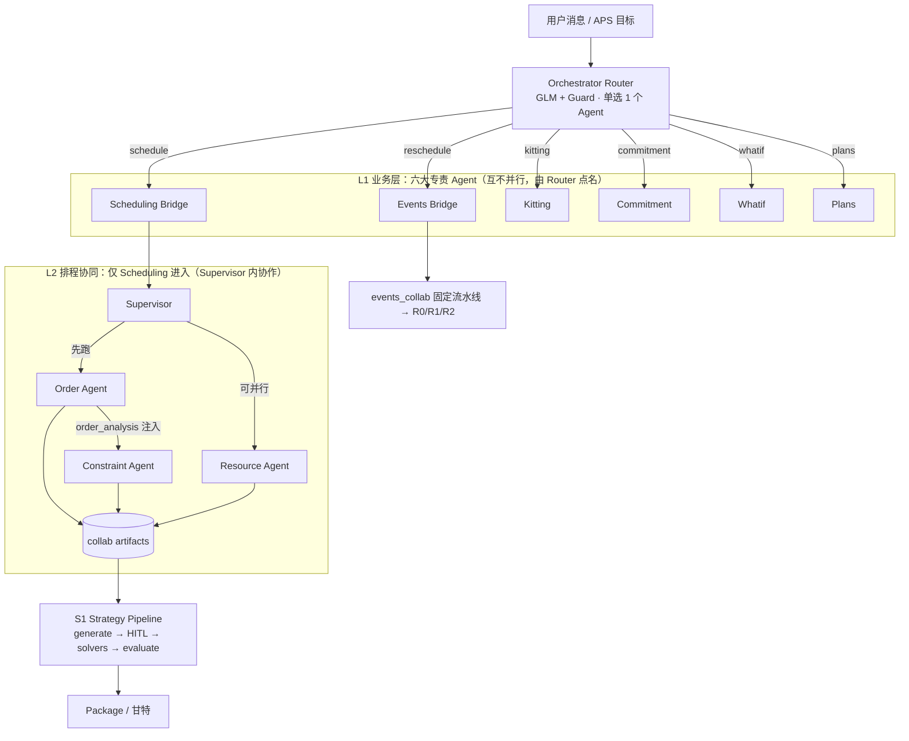
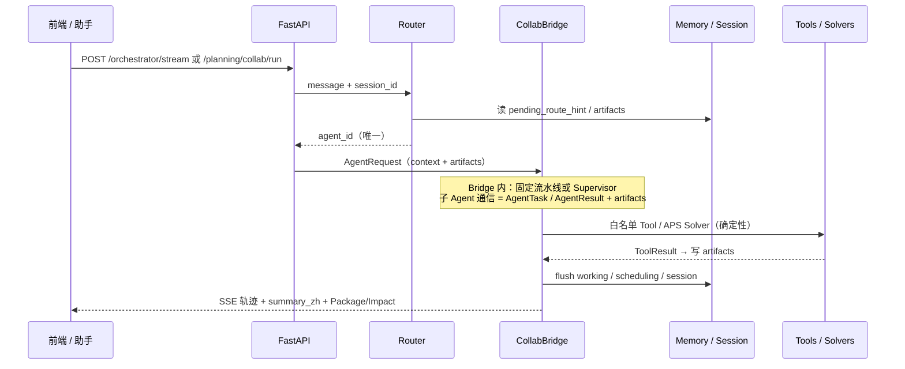
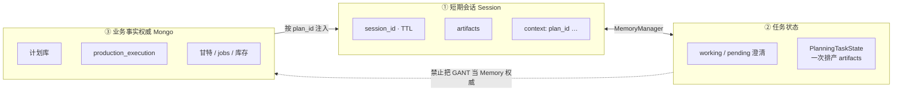

# MetaForge

MetaForge 是面向 **Job Shop 排产（JSSP）** 的模块化工具包：经典元启发式 + 强化学习求解器，并提供 **FastAPI + MongoDB + Vue3** 车间排产 Web 应用。

当前主分支：**`V1`** — 已完成 **S1–S4 产品闭环** + **S5 Harness 底座**（Runtime / Context / Skill / ToolExecutor / Memory 边界）。

---

## 快速启动（Windows）

```powershell
Start-Service MongoDB
pip install -e .
cd frontend; npm install; npm run build; cd ..
cd tests; python main.py
```

- 交付入口：`http://127.0.0.1:8008/new-ui/`（`METAFORGE_PORT` 默认 8008）
- 运行手册：[`star.md`](star.md)
- **面试 / 代码导览：** [`docs/V1-代码导览-面试官.md`](docs/V1-代码导览-面试官.md)
- 进度文档：[`docs/多智能体开发进度.md`](docs/多智能体开发进度.md)
- S5 计划：[`docs/superpowers/plans/2026-08-09-planning-harness-context-skill.md`](docs/superpowers/plans/2026-08-09-planning-harness-context-skill.md) · [`docs/superpowers/plans/2026-08-09-tool-executor-memory-boundary.md`](docs/superpowers/plans/2026-08-09-tool-executor-memory-boundary.md)

---

## V1 改造总览：产品主线

系统主线固定为：**先排好计划 → 再执行计划 → 最后处理异常**。



LLM **不算甘特、不改算法源码**；确定性 APS Solver 负责计算；`scheduled_event` 是仿真注入器，**不是第 7 个 Agent**。

---

## 系统架构总览（六岗 · 工作流 · Tool · Context · Memory）

主链路自左向右；六岗并排；Harness 横切；Tool 调用见下表（避免图里堆长文）。



**scheduling 岗内协作**（仅此岗再拆；系统仍是六岗）：



**谁调用哪些 Tool**（均经 `ToolExecutor` ← `registry.run_tool`）：

| 调用方 Agent | 主要 Tool |
|--------------|-----------|
| **scheduling** | `planning.strategy_generate` · `planning.strategy_evaluate` · `planning.run` · `scheduling.run` |
| **events** | `events.parse_event` · `events.reschedule` · `events.check_insert_job` / `merge_insert_job` |
| **kitting** | `material.check_static` · `material.compute_delays` · `kitting.build_report` |
| **commitment** | `delivery.assess` · `delivery.explain_impact` · `delivery.customer_script` |
| **whatif** | `compare.variants` 等 |
| **plans** | `data.list/load/bind_plan` · `data.propose_persist` / `confirm_persist` |

| 横切能力 | 要点 |
|----------|------|
| **Context** | 任务前编译，稳定 `context_hash`，不塞整表甘特 |
| **Memory** | TaskState / Session / Mongo 三分；禁止 gantt/jobs/库存当记忆权威 |
| **Tool** | deny / ask→HITL / allow；schema · timeout · retry |
| **边界** | Solver≠Agent；`scheduled_event`≠第 7 Agent；Agent 不互聊 |

---

## 改造计划与完成阶段

| 阶段 | 内容 | 状态 |
|------|------|------|
| **基线** | 14 Solver、六大业务 Agent、Tool 白名单、MES 仿真与事件重排、Vue `/new-ui` | ✅ 已完成 |
| **S1** | 参数化 `SchedulingStrategy` + 评价闭环 + HITL + `/api/planning/*` | ✅ 已闭环 |
| **S2** | Planning Supervisor + Order/Constraint/Resource → S1；scheduling 主路径 | ✅ 已闭环 |
| **S3** | 前端三模式（模板 / 参数化 / AI 策略）+ 完整结果页 | ✅ 已闭环 |
| **S4** | Package→仿真、预约动态事件、R0/R1/R2 对比 | ✅ 已闭环 |
| **S5** | 薄 Harness：`AgentRuntime` · `ContextCompiler` · Skill · `run_events` | ✅ **已落地** |
| **S5.1** | `ToolExecutor`（risk/校验/超时/重试）+ Memory 边界 | ✅ **已落地** |
| **暂缓** | 全面 LangGraph / MCP / 真实 MES·IoT / 复杂 RBAC | ⏸ 不做 |



---

## S5 / S5.1：Harness 底座（新改造）

在 S1–S4 **业务能力不推倒** 的前提下，给智能排产补齐面试级工程底座。

| 能力 | 做什么 | 代码 |
|------|--------|------|
| **AgentRuntime** | 子 Agent 经 Runtime 调度；`agent.start/end/error` 事件 | `metaforge/harness/runtime.py` |
| **ContextCompiler** | 编译排产上下文 + 稳定 `context_hash` | `metaforge/harness/context.py` |
| **Skill** | `planning_collab` 受信技能包；API/Bridge 经 `invoke_skill` | `metaforge/harness/skill.py` · `skills/planning_collab.py` |
| **run_trace** | 合并 `run_events` + `collab_trace` + `strategy_trace` | `metaforge/harness/trace.py` |
| **ToolExecutor** | `deny` 拒；`ask` 需批准/`skip_strategy_hitl`；schema/timeout/retry | `metaforge/harness/tool_executor.py`；`tools/registry.run_tool` 委托 |
| **Memory 边界** | TaskState ≠ Session Memory ≠ Mongo 事实；事实键写入告警 | `metaforge/memory/boundary.py` |

**验收：** `pytest tests/harness tests/planning_collab tests/strategy`（当前 82+ passed）。

**明确不做：** 全面 LangGraph、MCP、向量 RAG 查实时计划、Agent 自由群聊、LLM 改求解器源码。

规格：[`docs/superpowers/specs/2026-08-09-tool-executor-memory-boundary-design.md`](docs/superpowers/specs/2026-08-09-tool-executor-memory-boundary-design.md)


---

## S1 架构（当前已落地）

### 端到端数据流




### 模块分层




### S1 验收清单（打勾）

**策略与评价**

- `SchedulingStrategy` 统一模型（objectives / hard / soft / critical_orders …）
- 6 模板降级为 Preset，兼容旧 weights
- 硬/软约束扩展集 + 模拟数据标记 `simulated_fields`
- Context Builder（禁止全量 BOM/甘特入 Prompt）
- NL → Strategy：LLM + repair/retry + 规则回退
- Guardrails：约束白名单与实体校验
- Adapters：Strategy → weights / resource hints
- 轻量 SolverPolicy + Capability Matrix（RL 不假装支持动态多目标）
- Evaluator：硬约束淘汰 + 软约束去双计打分
- jobs → `JobShopProblem` 自动构建（HITL 批准可不传 problem）
- `fallback_solver`：primary 全失败时回退

**运行与接口**

- PlanningRun 状态机（含 `WAITING_APPROVAL`）
- 策略 HITL：approve / reject / edit_and_approve
- `/api/planning/`* + Feature Flag `PLANNING_STRATEGY_V1`
- Planning Tools：`planning.strategy_*` / `planning.run`
- Strategy Trace 写入 run 响应
- APS 轻量 UI（目标输入 / JSON 预览 / HITL / 结果）
- 黄金与 e2e 测试（`tests/strategy/`，当前 43+ 项相关用例通过）

**明确不做（S1）**

- ~~LLM 改求解器源码~~（禁止）
- ~~七 Agent Supervisor~~ → **S2**
- ~~完整前端三模式~~ → **S3**
- ~~LangGraph / 全面 MCP~~ → 暂缓

---

## S2 架构（Collab Multi-Agent，已落地）

### 两层多智能体关系




要点：**Agent 之间不互相聊天**；L1 由 Router 互斥调度；L2 由 Supervisor 编排，通过 **artifacts 字典** 传递分析结果。

### 通信机制




| 通道                   | 机制                          | 代码位置                                       |
| -------------------- | --------------------------- | ------------------------------------------ |
| 用户 ↔ 编排器             | REST / SSE                  | `tests/main.py` · `orchestrator/stream.py` |
| Router → 唯一 Bridge   | `intent → agent_id`         | `orchestrator/router.py`                   |
| Supervisor ↔ 子 Agent | `AgentTask` / `AgentResult` | `planning_collab/protocol.py`              |
| 子 Agent ↔ 下游         | **共享 artifacts**（非消息总线）     | `supervisor.py` 合并后入 S1                    |
| Bridge ↔ 能力 | Tool 白名单 → **ToolExecutor** | `tools/registry.run_tool` · `harness/tool_executor.py` |
| 跨轮续聊 | `session_id` + Memory（含边界） | 见下图 · `memory/boundary.py` |


### 记忆机制（三层 + 边界，S5.1）



| 层 | 存什么 | 文件 |
|----|--------|------|
| 短期会话 | artifacts、context、TTL | `orchestrator/session.py` |
| 任务状态 | working、pending、PlanningTaskState | `memory/manager.py` · `planning_collab/protocol.py` |
| 业务事实 | 计划 / MES / 甘特权威 | Mongo · `production_execution.py` |
| **边界** | 写 `gantt_data`/`jobs`/库存进 Memory → 告警；`METAFORGE_MEMORY_STRICT=1` 则报错 | `memory/boundary.py` |

少打 LLM：`preview.py` 缓存 Plan；`ContextCompiler` / `context_builder` 截断压缩。
更细跳转：[面试代码导览](docs/V1-代码导览-面试官.md)。

**验收要点**

- `metaforge.planning_collab`：协议 / 三分析规则 Agent / 可选 LLM 摘要 / Supervisor
- `/api/planning/collab/{analyze,run,runs/{id}}`，Flag `PLANNING_COLLAB_V1`（默认开）
- Orchestrator `scheduling` → `SchedulingCollabBridge`（Flag=0 回退旧 Runner）
- APS「智能排产运行」改调 collab；HITL 仍走 S1 `/api/planning/runs/...`
- 分析 artifacts 合并入 Strategy（critical / hard / soft）
- `collab_trace` / `run_events` / `run_trace`：Supervisor + 三 Agent + S1 strategy（经 Harness Runtime）
- e2e：摘要失败仍可 COMPLETED；`built_from_jobs` + recommended
- 测试：`tests/harness/` + `tests/planning_collab/` + strategy / router 回归
- 旧 scheduling **主路径已替换**；`SchedulingAgentRunner` **已删除**（`get_agent("scheduling")` 固定 Bridge；`PLANNING_COLLAB_V1` 仅控制 `/api/planning/collab/`* 开关）

### 同构迁移 Backlog（S2 不做，后续替换即删旧路径）


| 顺序  | 领域         | 备注                                                                |
| --- | ---------- | ----------------------------------------------------------------- |
| 1   | events     | ✅ 已闭环：`EventsCollabBridge` + `events_collab`（旧 Runner 已删）         |
| 2   | kitting    | ✅ 已闭环：`KittingCollabBridge` + `kitting_collab`（旧 Runner 已删）       |
| 3   | commitment | ✅ 已闭环：`CommitmentCollabBridge` + `commitment_collab`（旧 Runner 已删） |
| 4   | whatif     | ✅ 已闭环：`WhatifCollabBridge` + `whatif_collab`（旧 Runner 已删）         |
| 5   | plans      | ✅ 已闭环：`PlansCollabBridge` + `plans_collab`（旧 Runner 已删）           |


---

## S3 前端三模式（已落地）

APS 右侧以 `PlanningWorkbench` Tab 工作台替换旧 NL/权重面板：


| 模式       | 入口                 | 验收要点                                           |
| -------- | ------------------ | ---------------------------------------------- |
| **A 模板** | Preset 一键跑         | `preset_id` → `/api/planning/run`；默认可跳过策略 HITL |
| **B 参数** | 权重 + critical + 约束 | catalog 全量硬/软约束编辑；validate → run；默认 HITL       |
| **C AI** | NL 目标              | `/api/planning/collab/run` + 三分析摘要 + HITL      |
| **结果**   | Package 面板         | 推荐 ID、KPI、违规、理由、候选对比、`simulated_fields`        |
| **清理**   | APSView            | 旧 NL 排程 / 权重主入口已移除                             |


详细规格：`[docs/superpowers/specs/2026-08-03-planning-frontend-modes-design.md](docs/superpowers/specs/2026-08-03-planning-frontend-modes-design.md)`

---

## 阶段路线（已含 S5）


| 阶段 | 目标 | 关键产出 |
|------|------|----------|
| **S4** | 执行与异常闭环 | Package→仿真、预约动态事件、R0/R1/R2 对比导出 |
| **S5** | Agent 运行底座 | Runtime · ContextCompiler · Skill · run_trace |
| **S5.1** | Tool / Memory 治理 | ToolExecutor · Memory 边界 |

详细规格与决策见：

- [`docs/superpowers/specs/2026-08-03-parameterized-scheduling-strategy-design.md`](docs/superpowers/specs/2026-08-03-parameterized-scheduling-strategy-design.md)
- [`docs/superpowers/specs/2026-08-03-planning-collab-multiagent-design.md`](docs/superpowers/specs/2026-08-03-planning-collab-multiagent-design.md)
- [`docs/superpowers/specs/2026-08-03-planning-frontend-modes-design.md`](docs/superpowers/specs/2026-08-03-planning-frontend-modes-design.md)
- [`docs/superpowers/specs/2026-08-03-sim-scenario-compare-design.md`](docs/superpowers/specs/2026-08-03-sim-scenario-compare-design.md)
- [`docs/superpowers/specs/2026-08-09-tool-executor-memory-boundary-design.md`](docs/superpowers/specs/2026-08-09-tool-executor-memory-boundary-design.md)
- [`docs/superpowers/plans/`](docs/superpowers/plans/)

---

## 现有能力一览（基线，已完成）


| 能力 | 说明 |
|------|------|
| 14 类求解器 | 规则 / 元启发式 / RL（TS、GA、SA、ACO、EDD…、Q/DQN/PPO…） |
| 六大业务 Agent | scheduling / events / kitting / commitment / whatif / plans |
| Tool 白名单 + Executor | `GET /api/tools/registry`；执行经 `ToolExecutor` |
| Harness | Runtime · ContextCompiler · Skill · run_events |
| MES 执行仿真 | 倍速看板、预约动态事件、R0/R1/R2 |
| 智能助手 | Orchestrator + SSE + 落库 HITL |


---

## 算法库（Python Toolkit）

仍可作为独立 JSSP 求解库使用：

```python
from metaforge.problems.benchmark_loader import load_job_shop_instance
from metaforge.metaforge_runner import run_solver

problem = load_job_shop_instance("data/benchmarks/ft06.txt")
result = run_solver("ts", problem)
print("Best Makespan:", result["makespan"])
```

```bash
pip install metaforge
# 或开发安装
pip install -e .
```

更多：`[docs/usage.md](docs/usage.md)` · `[docs/solvers.md](docs/solvers.md)` · `[docs/datasets.md](docs/datasets.md)`

---

## 文档索引


| 文档                                                   | 用途            |
| ---------------------------------------------------- | ------------- |
| `[star.md](star.md)`                                 | 本机启动          |
| `[docs/智能体功能清单.md](docs/智能体功能清单.md)`                 | 六 Agent 能力主参考 |
| `[docs/多智能体开发进度.md](docs/多智能体开发进度.md)`               | 进度与已知限制       |
| `[docs/改进计划.md](docs/改进计划.md)`                       | 历史改进目标        |
| `[docs/软件说明书.md](docs/软件说明书.md)`                     | 软件说明          |
| [`docs/superpowers/specs/`](docs/superpowers/specs/) | 设计规格（含 S5.1 Tool/Memory） |
| [`docs/superpowers/plans/`](docs/superpowers/plans/) | 实现计划（含 S5 Harness） |
| 上文「系统架构总览」 | 六岗 · Tool 调用 · Context · Memory 总图 |


---

## License

MIT License — free for academic and commercial use.

---

> MetaForge V1：确定性求解为核，参数化策略为脑，六岗 Agent 协作 + Harness（Context / Tool / Memory / Trace）与仿真闭环。

