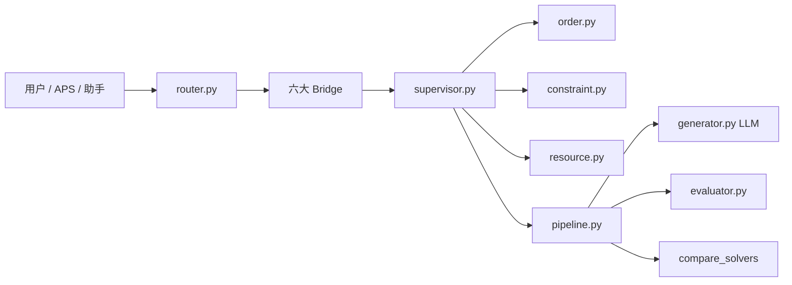

# MetaForge V1 · 核心代码跳转

> 在 Cursor / VS Code 里 **Ctrl+单击**（或 Cmd+单击）下面链接即可跳到文件。  
> 启动演示：[`star.md`](../star.md)

---

## 业务主线（排产 → 执行 → 异常）

| 做什么 | 点这里 |
|--------|--------|
| 后端总入口 / API | [`tests/main.py`](../tests/main.py) |
| 策略闭环（生成→求解→评价→Package） | [`src/metaforge/strategy/pipeline.py`](../src/metaforge/strategy/pipeline.py) |
| 硬约束筛方案 + 综合分选推荐 | [`src/metaforge/strategy/evaluator.py`](../src/metaforge/strategy/evaluator.py) |
| 策略 → 求解器权重 | [`src/metaforge/strategy/adapters.py`](../src/metaforge/strategy/adapters.py) |
| 策略数据结构 | [`src/metaforge/strategy/models.py`](../src/metaforge/strategy/models.py) |
| 多算法对比求解 | [`src/metaforge/utils/compare_solvers.py`](../src/metaforge/utils/compare_solvers.py) |
| 异常重排 R0/R1/R2 | [`src/metaforge/services/event_reschedule.py`](../src/metaforge/services/event_reschedule.py) |
| MES 执行仿真 | [`src/metaforge/services/production_execution.py`](../src/metaforge/services/production_execution.py) |
| Package 送入仿真 | [`src/metaforge/services/package_to_execution.py`](../src/metaforge/services/package_to_execution.py) |

**前端业务页**

| 做什么 | 点这里 |
|--------|--------|
| APS 排程中心 | [`frontend/src/views/APSView.vue`](../frontend/src/views/APSView.vue) |
| AI 协同排产工作台 | [`frontend/src/components/planning/PlanningWorkbench.vue`](../frontend/src/components/planning/PlanningWorkbench.vue) |
| AI 策略输入面板 | [`frontend/src/components/planning/ModeAiPanel.vue`](../frontend/src/components/planning/ModeAiPanel.vue) |
| Package 结果 | [`frontend/src/components/planning/PackageResultPanel.vue`](../frontend/src/components/planning/PackageResultPanel.vue) |
| 生产看板 | [`frontend/src/views/DashboardView.vue`](../frontend/src/views/DashboardView.vue) |
| 智能助手 | [`frontend/src/components/AgentChatPanel.vue`](../frontend/src/components/AgentChatPanel.vue) |
| 多算法报表 | [`frontend/src/views/AnalysisView.vue`](../frontend/src/views/AnalysisView.vue) |

---

## Agent（多智能体）

### 外层：六大业务 Agent（一次请求只跑一个）

| Agent | 点这里 |
|-------|--------|
| 意图路由（选哪个 Agent） | [`src/metaforge/orchestrator/router.py`](../src/metaforge/orchestrator/router.py) |
| Agent 注册表 | [`src/metaforge/agents/registry_meta.py`](../src/metaforge/agents/registry_meta.py) |
| 排程 Bridge | [`src/metaforge/agents/scheduling_collab_bridge.py`](../src/metaforge/agents/scheduling_collab_bridge.py) |
| 异常 Bridge | [`src/metaforge/agents/events_collab_bridge.py`](../src/metaforge/agents/events_collab_bridge.py) |
| 齐套 Bridge | [`src/metaforge/agents/kitting_collab_bridge.py`](../src/metaforge/agents/kitting_collab_bridge.py) |
| 交期 Bridge | [`src/metaforge/agents/commitment_collab_bridge.py`](../src/metaforge/agents/commitment_collab_bridge.py) |
| 对比 Bridge | [`src/metaforge/agents/whatif_collab_bridge.py`](../src/metaforge/agents/whatif_collab_bridge.py) |
| 计划 Bridge | [`src/metaforge/agents/plans_collab_bridge.py`](../src/metaforge/agents/plans_collab_bridge.py) |

### 内层：排程协同（Order + Constraint + Resource）

| 角色 | 点这里 |
|------|--------|
| Supervisor 编排 | [`src/metaforge/planning_collab/supervisor.py`](../src/metaforge/planning_collab/supervisor.py) |
| 订单分析 Agent | [`src/metaforge/planning_collab/agents/order.py`](../src/metaforge/planning_collab/agents/order.py) |
| 约束分析 Agent | [`src/metaforge/planning_collab/agents/constraint.py`](../src/metaforge/planning_collab/agents/constraint.py) |
| 资源分析 Agent | [`src/metaforge/planning_collab/agents/resource.py`](../src/metaforge/planning_collab/agents/resource.py) |
| 协议定义 | [`src/metaforge/planning_collab/protocol.py`](../src/metaforge/planning_collab/protocol.py) |
| 异常流水线 | [`src/metaforge/events_collab/pipeline.py`](../src/metaforge/events_collab/pipeline.py) |

---

## LLM（大模型）

> GLM 只做理解 / 路由 / 策略 JSON / 摘要；**不算甘特**。

| 做什么 | 点这里 |
|--------|--------|
| HTTP 客户端（智谱） | [`src/metaforge/orchestrator/llm/client.py`](../src/metaforge/orchestrator/llm/client.py) |
| 节点链（router/plan/summarize…） | [`src/metaforge/orchestrator/llm/chain.py`](../src/metaforge/orchestrator/llm/chain.py) |
| 开关与降级 | [`src/metaforge/orchestrator/llm_config.py`](../src/metaforge/orchestrator/llm_config.py) |
| 意图 LLM 路由 | [`src/metaforge/orchestrator/llm_router.py`](../src/metaforge/orchestrator/llm_router.py) |
| 策略生成（LLM + 规则兜底） | [`src/metaforge/strategy/generator.py`](../src/metaforge/strategy/generator.py) |
| 排程意图解析 | [`src/metaforge/scheduling/llm_intent.py`](../src/metaforge/scheduling/llm_intent.py) |
| 事件口语解析 | [`src/metaforge/events/llm_event.py`](../src/metaforge/events/llm_event.py) |
| 对话摘要 | [`src/metaforge/orchestrator/llm_summarize.py`](../src/metaforge/orchestrator/llm_summarize.py) |
| Env 模板 | [`.env.example`](../.env.example) |

---

## 架构一眼看懂

---

## 现场 5 个必点

1. [`router.py`](../src/metaforge/orchestrator/router.py) — 怎么选 Agent  
2. [`supervisor.py`](../src/metaforge/planning_collab/supervisor.py) — 排程多智能体怎么协作  
3. [`order.py`](../src/metaforge/planning_collab/agents/order.py) — 规则分析长什么样  
4. [`generator.py`](../src/metaforge/strategy/generator.py) — LLM 怎么出策略  
5. [`evaluator.py`](../src/metaforge/strategy/evaluator.py) — 怎么筛推荐方案  
