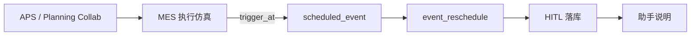

# 事件驱动执行闭环硬化 实现计划

> **面向 AI 代理的工作者：** 必需子技能：使用 superpowers:subagent-driven-development（推荐）或 superpowers:executing-plans 逐任务实现此计划。步骤使用复选框（`- [ ]`）语法来跟踪进度。

**目标：** 在已落地的事件驱动主线上，补齐预约队列、可观测性、助手边界与回归资产。

**架构（不变）：**  
仿真时钟 → `scheduled_event` 注入（Harness，非 Agent）→ `dispatch_event_reschedule` → R0/R1/R2 → 暂停 HITL；助手仅事后说明。六岗 Agent 仍是岗位；不恢复扰动剧本。

**技术栈：** FastAPI + Motor/Mongo、Vue3、pytest。

---

## 已完成（勿再做）

| 项 | 说明 |
|----|------|
| 统一 `scheduled_event` | 8 类动态事件预约/触发；兼容旧 `schedule_breakdown` |
| 故障重排语义 | 禁止冻进故障窗；有替代机台可从 freeze 起开工 |
| 对比甘特 | 扩展事件带 r0/r1/r2；故障红窗 / 停机橙窗 |
| 扰动剧本移除 | `metaforge.scenario`、ScenarioPanel、`/api/scenarios*` 已删 |
| 看板信息架构 | 执行/甘特 → **异常重排** → 数字孪生 |
| 预约 UI 主次 | 「预约动态事件」为主；立即故障为 plain |
| 演示脚本 | `star.md` 主线已改为预约注入；NL 标为口语备用 |
| 相关单测 | `test_scheduled_event*.py`、`test_machine_breakdown_recovery.py`、`test_scheduled_event_all_types.py` |
| 文档局部 | 进度文档/S4 索引已标注剧本移除；计划索引已挂本文件 |

---

## 剩余阶段

| 阶段 | 名称 | 优先级 |
|------|------|--------|
| **A** | 叙事扫尾（导览/README 残留表述） | P0 |
| **B** | 预约队列 + 下一预约可见 | P0 |
| **C** | 助手边界（NL 非传感器） | P1 |
| **D** | Fire 路径 E2E + 回归勾选 | P1 |
| **E** | 时间线 / 孪生高亮 | P2 / 可砍 |

---

### 任务 A1：文档扫尾

**文件：** `README.md`、`docs/V1-代码导览-面试官.md`、`star.md`（补一句即可）

- [ ] 搜索并改掉仍把「剧本 / NL」写成主触发的句子  
- [ ] 导览补 `scheduled_event` / `maybe_fire_scheduled_event` 路径  
- [ ] `star.md` 避坑补：改后端后必须重启（`METAFORGE_RELOAD=0`）  
- [ ] Commit：`docs: finish event-driven narrative sweep`

---

### 任务 B1：预约队列

**问题：** 同时只能一条 `scheduled_event`。

**文件：**
- `src/metaforge/services/production_execution.py`
- `frontend/src/components/MesReschedulePanel.vue`
- `tests/test_scheduled_event_queue.py`（新建）

- [ ] 失败测试：2 条 pending，越过第一点只 fire 第一条  
- [ ] `scheduled_events: []` + 兼容旧单字段  
- [ ] CAS 认领最早 `trigger_at`  
- [ ] UI 队列标签 + 按 id 取消  
- [ ] Commit：`feat(execution): support scheduled event queue`

---

### 任务 B2：下一预约可观测

**文件：** `production_execution.get_state`、`MesReschedulePanel.vue` / `DashboardView.vue`

- [ ] 返回 `pending_count / next_trigger_at / last_fired`  
- [ ] 异常重排区展示「下一预约 @ Xh」  
- [ ] Commit：`feat(ui): show next scheduled event`

---

### 任务 C1：助手 = 事后说明

**文件：** `useAssistantStore.js`、`AgentChatPanel.vue`、`orchestrator/llm/prompts.py`

- [ ] 事件类意图引导「先看板预约/执行中」  
- [ ] 系统推送文案统一为注入已完成 + 请 HITL  
- [ ] Commit：`refactor(assistant): demote NL as event sensor`

---

### 任务 D1：Fire 路径 E2E

**文件：** `tests/test_scheduled_event_fire_e2e.py`（新建）

- [ ] 内存假 collection：`schedule` → 拨 `sim_time` → `maybe_fire` → notify  
- [ ] 覆盖 breakdown / downtime / insert；断言不盖故障窗  
- [ ] Commit：`test(execution): e2e scheduled event fire path`

---

### 任务 D2：演示回归勾选

**文件：** `star.md` 或进度文档短表

- [ ] 勾选：示例 → AI 策略 → 仿真 → 预约故障 → 触发 → 红窗 → HITL  
- [ ] 勾选：停机/插单一轮有左右甘特  
- [ ] Commit：`docs: add demo regression checklist`

---

### 任务 E1（可选）：队列时间线条

依赖 B1。不做剧本编辑器回潮。

### 任务 E2（可选）：孪生故障高亮

与 `breakdown_window` 同字段。

---

## 明确不做

| 不做 | 原因 |
|------|------|
| 新增预约 Agent | Harness 注入即可 |
| 恢复扰动剧本 | 已删除 |
| 全面 LangGraph / 真 IoT | 暂缓 |

---

## 建议顺序

1. **A1**（短）→ **B2**（短）→ **B1**（主）→ **D1**  
2. **C1** → **D2**  
3. **E\*** 按需  

---

## 剩余验收

- [ ] 可同时挂 ≥2 条预约并按时刻依次触发  
- [ ] 看板可见「下一预约」  
- [ ] 导览/README 无剧本主触发表述  
- [ ] Fire E2E 测试绿；既有 `test_scheduled_event*` / breakdown 测试保持绿  
