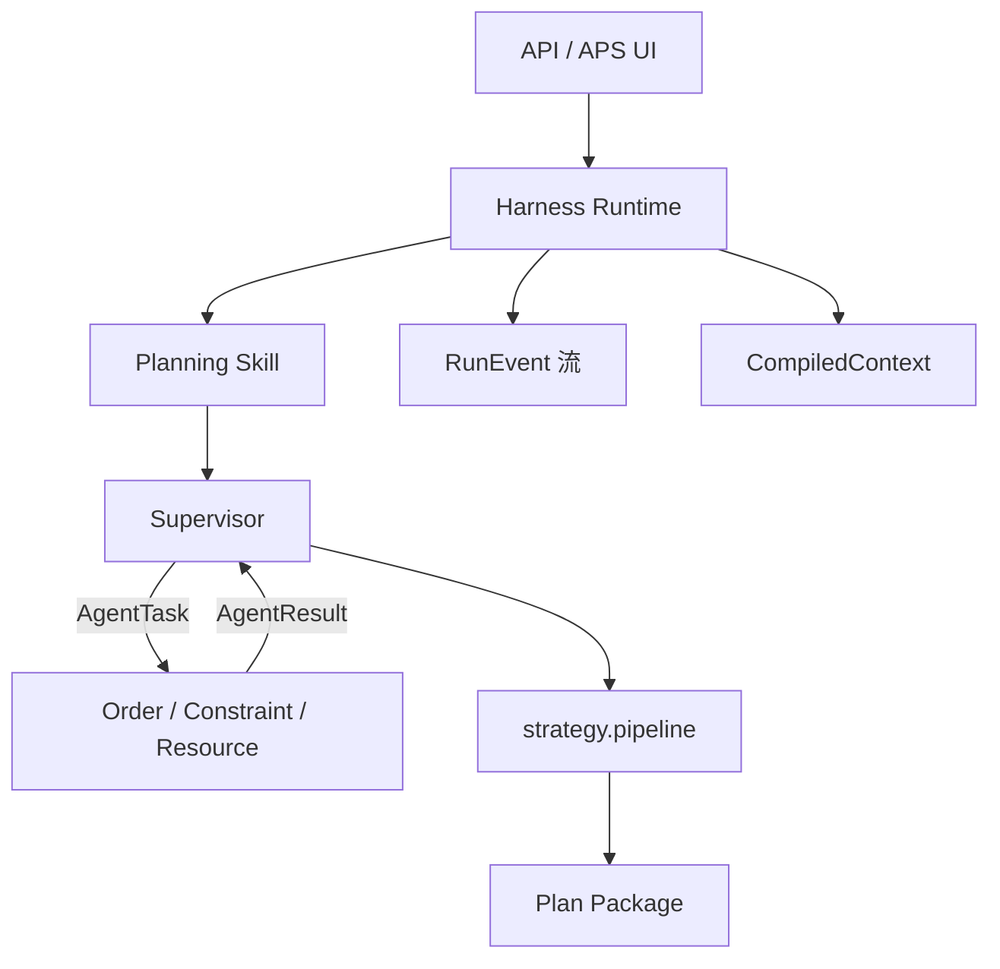

# 智能排产：Harness → 上下文 → Skill 实现计划

> **面向 AI 代理的工作者：** 必需子技能：使用 superpowers:subagent-driven-development（推荐）或 superpowers:executing-plans 逐任务实现此计划。步骤使用复选框（`- [ ]`）语法来跟踪进度。

**目标：** 在已闭环的 S1/S2/S3 排产主链上，补齐面试级工程底座：薄 Harness、统一上下文编译、受信 Skill——不重写 Solver，不引入 LangGraph。

**架构：**  
`API → Harness.Runtime（compile once）→ Planning Skill → Supervisor（AgentTask/Result）→ S1 strategy pipeline → Package`  
轨迹统一为 `RunEvent[]`；上下文由 `ContextCompiler` 一次产出；Skill 声明工具白名单与策略门控。

**技术栈：** Python 3.10+、现有 `planning_collab` / `strategy` / `ToolSpec`、pytest、FastAPI（`tests/main.py` 仅接线）。

**范围：** 仅智能排产。动态重排 / 预约事件不在本计划。

**不做：** 微服务拆分、自由 Agent Room、向量 RAG 查实时计划、全面 MCP、改 14 求解器内核。

---

## 现状（已有，勿推倒）

| 已有 | 路径 |
|------|------|
| 策略流水线 | `strategy/pipeline.py`、`generator`、`evaluator` |
| Supervisor 协作 | `planning_collab/supervisor.py` + Order/Constraint/Resource |
| 协议 | `AgentTask` / `AgentResult` / `PlanningTaskState` |
| LLM 上下文裁剪 | `strategy/context_builder.py`（仅策略生成） |
| Tool 契约字段 | `tools/base.ToolSpec`（多数未真正执行门控） |
| 轨迹碎片 | `collab_trace` / `strategy_trace` / orchestrator `execution_trace` 各写各的 |

| 缺口 | 说明 |
|------|------|
| 无 Runtime/Harness 包 | Supervisor 直接调 agent 函数 |
| 无统一 RunEvent | Preview/Run/SSE 难共用一份运行对象 |
| Context 多源 | session / ToolContext / context_builder / task_state 分叉 |
| 无 Skill | 排产流程未收成可挂载受信包 |

---

## 文件结构

| 路径 | 职责 |
|------|------|
| `src/metaforge/harness/__init__.py` | 导出 Runtime / 类型 |
| `src/metaforge/harness/types.py` | `RunEvent`、`CompiledRun`、`HarnessResult` |
| `src/metaforge/harness/runtime.py` | 跑 AgentTask、记事件、超时包装 |
| `src/metaforge/harness/trace.py` | 合并 collab + strategy → 统一 `run_events` |
| `src/metaforge/harness/context.py` | `ContextCompiler`（阶段 B） |
| `src/metaforge/harness/skill.py` | `SkillSpec` + registry（阶段 C） |
| `src/metaforge/skills/planning_collab.py` | 排产 Skill 定义（阶段 C） |
| `src/metaforge/planning_collab/supervisor.py` | 经 Runtime 调度子 Agent |
| `tests/harness/test_*.py` | 单测 |
| `docs/superpowers/plans/README.md` | 索引 |

---

## 阶段 A：薄 Harness（先做）

### 任务 A1：类型 + Runtime 跑 AgentTask

**文件：** `harness/types.py`、`harness/runtime.py`、`tests/harness/test_runtime.py`

- [x] 失败测试：`runtime.run_agent(task, runner)` → `AgentResult` + 至少 2 条 `RunEvent`（start/end）
- [x] 实现 `RunEvent(type, ts, agent_id?, payload)`、`AgentRuntime`
- [x] runner 抛错 → `AgentResult(status=failed)` + error 事件（不炸穿）
- [ ] Commit：`feat(harness): add AgentRuntime and RunEvent`（待用户要求再提交）

### 任务 A2：Supervisor 经 Runtime

**文件：** `planning_collab/supervisor.py`、`tests/harness/test_supervisor_runtime.py`

- [x] `_run_one` 改为 `AgentRuntime.run_agent`
- [x] `run_collab_analyze` / `run_collab` 返回 `run_events`（列表）
- [x] 既有 planning_collab 测试保持绿
- [ ] Commit：`refactor(collab): dispatch agents via harness runtime`

### 任务 A3：统一轨迹合并

**文件：** `harness/trace.py`、改 `build_collab_trace` 调用方

- [x] `merge_run_trace(collab_trace, strategy_trace, events) → {run_events, collab_trace, strategy_trace}`
- [x] `run_collab` 输出带 `run_trace`（含 `run_events`）
- [ ] Commit：`feat(harness): merge planning run traces`

**阶段 A 验收：** collab/run API 多 `run_events`；子 Agent 失败不拖垮 Runtime；旧 `collab_trace` 仍在（兼容）。

---

## 阶段 B：上下文统一编译

### 任务 B1：ContextCompiler

**文件：** `harness/context.py`、`tests/harness/test_context_compiler.py`

- [x] `compile_planning_context(user_goal, jobs, machines, session?)` → `CompiledContext`
- [x] 字段：`goal_truncated`、`orders_summary`、`machines`、`catalog_digest`、`artifacts` 槽、`context_hash`
- [x] 复用 `strategy/context_builder` 的裁剪逻辑，不复制粘贴两份业务规则
- [ ] Commit：`feat(harness): ContextCompiler for planning`

### 任务 B2：接线 generate / collab

**文件：** `strategy/generator.py` 或 pipeline、`supervisor.py`

- [x] generate / collab 入口先 `compile`，同 `context_hash` 写入 run / task_state
- [x] 单测：同一输入两次 hash 稳定
- [ ] Commit：`refactor(planning): use compiled context in collab path`

**阶段 B 验收：** Preview（若有）与 Run 可对同一 `context_hash`；LLM prompt 吃 CompiledContext。

---

## 阶段 C：Skill

### 任务 C1：SkillSpec + Registry

**文件：** `harness/skill.py`、`tests/harness/test_skill_registry.py`

- [x] `SkillSpec(id, name_zh, allowed_tools, risk_level, entrypoint)`
- [x] `register_skill` / `get_skill`；未知 skill → 明确错误
- [ ] Commit：`feat(harness): skill registry`

### 任务 C2：Planning Collab Skill

**文件：** `skills/planning_collab.py`、API 或 bridge 薄封装

- [x] Skill 入口调用现有 `run_collab`（经 Runtime）
- [x] `scheduling_collab_bridge` 或 `/api/planning/collab/run` 可走 `runtime.invoke_skill("planning_collab", ...)`
- [ ] Commit：`feat(skills): register planning_collab skill`

**阶段 C 验收：** 排产主路径可表述为「调用受信 Skill」；工具白名单可查询；无 Skill 时行为与现网一致回退。

---

## 建议顺序与提交节奏

1. A1 → A2 → A3（每任务一 commit）  
2. B1 → B2  
3. C1 → C2  
4. 文档：`README` / 进度里加一节「Harness 底座」，标 S5

---

## 总验收

- [ ] `pytest tests/harness tests/planning_collab` 绿  
- [ ] `/api/planning/collab/run` 仍返回 package；新增 `run_events` / `run_trace`  
- [ ] 无 LangGraph / 无改 Solver 内核  
- [ ] 计划索引已挂本文件；S4.1 事件计划保持旁路（非本线）
